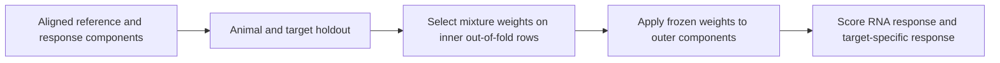

# StrokePerturb

StrokePerturb assembles gene-level RNA response forecasts from a reference term, a low-rank response, and two full-RNA components for composition and within-class expression. The repository contains the numerical calibration and scoring code, a synthetic quick start, and replays for public perturbation and expression datasets.



The command line consumes aligned component arrays. The Python package also exposes the training-label decomposition and fixed linear kernel primitives used to construct components. End-to-end reconstruction of the original mouse checkpoint requires the original upstream inputs, feature construction, and audit workflow. The public cell-line replays fit within their own assays. The Lrg1 and ISP replays quantify measured expression contrasts in separate stroke cohorts.

## Preparation

Python 3.11 or newer. The core and all examples run on CPU.

```bash
python -m venv .venv
```

Activate it with `source .venv/bin/activate` on macOS/Linux or `.venv\Scripts\Activate.ps1` in Windows PowerShell. From the repository root, install the core or use the reproduction dependencies.

```bash
python -m pip install -e .
python -m strokeperturb demo
```

```bash
python -m pip install -r requirements.txt
```

## Repository layout

```text
strokeperturb/   component construction, calibration, losses, and fold construction
reproduce/       dataset manifests, analysis entry points, and summary plots
docs/            model inputs, endpoint definitions, and evidence scope
```

## Preparing datasets and reproducing results

Download inputs from the public sources in the [reproduction guide](reproduce/README.md). The guide describes the analysis unit, fixed comparisons, and commands for each replay. Store input archives in `data/` and write generated tables and plots under `res/`.

| Figure | Entry point | Reproduced computation |
| --- | --- | --- |
| 1–2, method demonstration | `python -m strokeperturb demo` | Synthetic example of the inner calibration and outer scoring workflow |
| 3a–e | [`reproduce/fig3/`](reproduce/fig3/) | Norman K562 whole-pair holdout with no-change, additive, fitted ridge, and rank-16 response projection |
| 3f | [`gse245386_lrg1.py`](reproduce/fig3/gse245386_lrg1.py) | Animal-level measured Lrg1 genotype contrast after stroke |
| 4a–f | [`combosciplex.py`](reproduce/fig4/combosciplex.py) | A549 whole-pair holdout, with same-input linear and composition/within-state fits |
| 4h | [`gse168934_isp.py`](reproduce/fig4/gse168934_isp.py) | Animal-level measured ISP–vehicle expression contrast after stroke |
| 5 | [`h9_interpolation.py`](reproduce/fig5/h9_interpolation.py) | Public H9 endpoint-only mean interpolation and endpoint-carry baselines |

The numerical replays use the public comparison designs and their recorded gene axes. Summary plots cover selected analysis panels. Full manuscript slide assembly and the original reserved outcomes are outside this repository.

## Model interface

See the [component and evaluation specification](docs/model.md) for the ordered NPZ schema, fitted coefficient grid, and the distinction between the original mouse design and public comparisons.

## Data citations

The reproduction guide links the individual data records and associated primary papers. Cite each underlying study when using its data or derived results.
