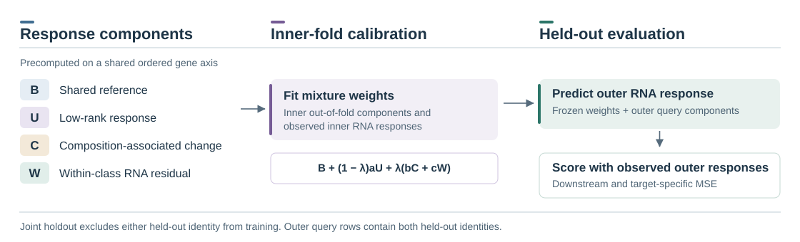

# StrokePerturb

**Predicting population-level transcriptional responses under animal and target holdout**

StrokePerturb combines a reference term, a low-rank response, and two full-RNA components that represent composition-associated change and within-class expression residuals. It calibrates their contributions on inner out-of-fold predictions and applies the selected weights to held-out animal–target populations.



## Installation

Python 3.11 or later. The core and reproduction scripts run on CPU.

```bash
git clone https://github.com/shumao469/StrokePerturb.git
cd StrokePerturb
python -m pip install -e .
```

For the public dataset replays and plotting, run `python -m pip install -r requirements.txt` from the repository root.

## Model input

The command-line interface accepts `.npz` files containing aligned response components. Each row represents one animal–target population.

| Key | Content |
| --- | --- |
| `source`, `target` | Unicode animal and target identifiers, one pair per row |
| `genes` | Ordered Unicode gene identifiers, shared across all component arrays |
| `background`, `U`, `C`, `W` | Population × gene matrices for the reference, low-rank response, composition-associated change and within-class residual |
| `truth` | Observed RNA change on the same axes. Supply it for calibration and scoring. The prediction input omits this key. |

In the original assay, separate halves of matched non-targeting controls serve the query and evaluation stages. Full replay of the original mouse checkpoint requires its scope-specific upstream inputs and audit workflow. See the [model specification](docs/model.md) for data shapes, control construction, and endpoint definitions.

## Features

- Joint holdout by animal and perturbation target.
- C/W training-label decomposition, fixed linear residual kernels and rank-16 response projection.
- Inner-fold calibration of `B + (1 − λ)aU + λ(bC + cW)` and comparison with the strongest single response family selected on those folds.
- Target-macro MSE for downstream and within-animal-centred responses, with the perturbed gene masked.

## Calibrate, predict and score

Build the inner component bundle from out-of-fold predictions restricted to outer training data. Freeze the calibration before applying it to the outer query. The scorer rebuilds the fixed forecast from the same outer components and calibration, then evaluates it against the supplied truth.

```bash
strokeperturb calibrate inner_oof.npz calibration.json
strokeperturb predict outer_components.npz forecasts.npz --calibration calibration.json
strokeperturb score outer_with_truth.npz scores.json --calibration calibration.json
```

## Python example

This synthetic example holds out one animal and two targets. The arrays illustrate the API using precomputed components.

```python
import numpy as np
from strokeperturb import apply_calibration, calibrate_inner, score_outer

genes = ["A", "B", "C", "D", "marker"]
zero = np.zeros((2, len(genes)))
w = zero.copy()
w[:, -1] = [-1, 1]

inner = {"background": zero, "U": zero, "C": zero, "W": w}
frozen = calibrate_inner(0.5 * w, inner, ["train"] * 2, ["A", "B"], genes)

outer = {**inner, "W": 2 * w}
axes = (["test"] * 2, ["C", "D"], genes)
forecasts = apply_calibration(outer, *axes, frozen)
report, _ = score_outer(w, outer, *axes, frozen)

print(forecasts["candidate"].shape)
print(report["scores"]["candidate"])
```

## Demo and public replays

Run `python -m strokeperturb demo` for a deterministic example that prints split sizes, selected coefficients and scores. The [reproduction guide](reproduce/README.md) gives download links, commands and expected results for the workflows below.

| Dataset | Workflow |
| --- | --- |
| Norman K562 · GSE133344 | Whole-pair genetic perturbation prediction with measured singles and no-change, additive and linear baselines |
| ComboSciPlex A549 · GSE206741 | Held-out drug-pair prediction with same-input fitted linear and C/W comparisons |
| Lrg1 · GSE245386 | Measured animal-level KO–WT expression contrast after stroke |
| ISP · GSE168934 | Measured animal-level post-stroke drug–vehicle expression contrast |
| H9 · GSE75748 | Endpoint-only interpolation of group mean expression at intermediate time points |

The cell-line workflows fit within their own assays. The Lrg1 and ISP workflows summarize observed expression, and the H9 workflow evaluates a fixed interpolation rule.

## Citation and contact

When referring to the software, cite the [StrokePerturb repository](https://github.com/shumao469/StrokePerturb) and the commit used. Cite the original studies for any data or derived results using the references in the [reproduction guide](reproduce/README.md).

Use [GitHub Issues](https://github.com/shumao469/StrokePerturb/issues) for questions and reproducibility reports.
